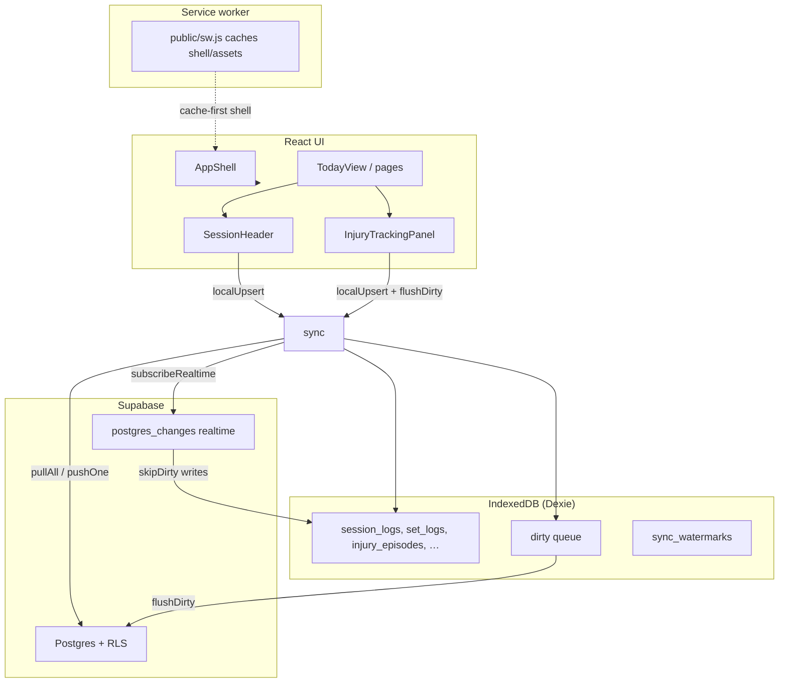

# Client layer architecture (Claude analysis brief)

**Purpose:** This document describes the architecture of the workout app’s **local-first client layer** — the files that control boot, offline cache, Supabase sync, PWA caching, and key session UI. It is written for Claude (or other agents) doing code review, regression analysis, or feature work in this area.

**Scope (files covered):**

| File | Role |
|------|------|
| `src/components/AppShell.tsx` | Auth gate, DB init, ready/sync state, periodic sync, SW registration |
| `src/lib/sync.ts` | Pull/push, dirty queue, `localUpsert`, realtime fan-in |
| `src/lib/db.ts` | Dexie schema (referenced; not fully documented here) |
| `src/lib/syncCodec.ts` | `toRemote` / `fromRemote` (referenced) |
| `public/sw.js` | PWA cache versioning and fetch strategies |
| `src/components/SessionHeader.tsx` | Active session header (trimmed UI) |
| `src/components/InjuryTrackingPanel.tsx` | Injury/body-state panel with collapse |

**Out of scope:** progression engine, program editor, readiness scoring logic, Postgres migrations.

---

## High-level data flow



**Invariant:** All user writes go **Dexie first**, then the **dirty queue**, then **async push** via `flushDirty()`. Reads come from Dexie (hooks). Network is enhancement, not requirement for UI render.

---

## AppShell.tsx — application shell and boot sequence

`AppShell` wraps every authenticated route. It owns three gates:

| State | Meaning |
|-------|---------|
| `dbReady` | `initDb(userId)` completed |
| `ready` | Local seed done; children may render |
| `syncing` | Background pull/backfill/flush in progress (UI hint only) |

### Boot sequence (critical path vs background)

```
getUser() → redirect /login if absent
  → initDb(user.id)
  → setCachedUserId(user.id)
  → 100ms delay (Supabase client header registration)
  → ensureLocalSeed()
  → setUserId, setDbReady, setSyncing(true), setReady(true)   ← UI UNBLOCKS HERE
  → [background try]
       backfillSessionDurations()
       seedRemotePrescriptionsIfEmpty()
       seedRemoteTemplatesIfEmpty()
       pullAll({ full: true }) with 15s timeout
       repairOpeningPrBaselineSession()
       backfillCardioFromSets()
       flushDirty()
     [finally setSyncing(false)]
```

**Design intent (recent fix):** Sync failures must **never** block `setReady(true)`. Only `initDb` / `ensureLocalSeed` failures hit the outer `catch` and set `error`. Background sync errors are `console.warn` only.

**Loading UI:** Rendered while `!dbReady || !ready`. Shows “Syncing…” when `dbReady && ready && syncing`.

### Post-ready effects (depend on `ready`)

1. **Periodic sync** — every 30s `flushDirty`; every 5min + on `visibilitychange` / `online`: `pullAll()` then `flushDirty()`. Errors swallowed (offline-normal).
2. **Realtime** — `subscribeRealtime(userId)` when `ready && userId`.
3. **Service worker** — registered only in **production** after `ready` (dev avoids stale caches).
4. **Tracker reminders** — polling when `ready`.

### What AppShell does *not* do

- Does not call `setMode` / deload toggles (those live in ReadinessForm / TodayView logic).
- Does not own session lift cards or prescriptions.

---

## sync.ts — sync engine

### Write path: `localUpsert` / `localDelete`

```ts
localUpsert(table, row) → Dexie.put(row) → enqueueDirty(table, rowId, 'upsert')
localDelete(...)         → Dexie.delete   → enqueueDirty(..., 'delete')
```

- `skipDirty: true` — used when applying realtime payloads (avoid push loops).
- `userId` injected via `withUserIdLocal` before local store.
- Row shape for Postgres: `toRemote()` in `syncCodec.ts` (camelCase → snake_case; optional fields as `undefined` locally, not `null`).

### Pull path: `pullAll(opts?)`

- Iterates `ALL_TABLES` with per-table `updated_at` watermarks in Dexie (`sync_watermarks`).
- `opts.full: true` — ignore watermarks (first sync after login).
- Per-table errors are collected and logged; **`pullAll` does not throw** on partial failure (degraded load).
- Catalog table `lifts` tolerates missing relation errors (optional remote catalog).

### Push path: `flushDirty()`

1. Load dirty rows, sort via `sortDirtyQueueForFlush` (upserts before deletes, stable order).
2. For each row: `pushOne` → Supabase `upsert` or `delete`.
3. On success: `db.dirty.delete(item.id)`.
4. On **401 / PGRST301 / jwt** message: one `refreshSession()` + retry.
5. On **any other error**: log, **skip row**, leave in dirty queue — **does not throw**.

**Why `flushDirty` must not throw:** AppShell init and periodic timers call it without wrapping; a thrown error previously blocked `setReady(true)` and caused a perpetual loading screen.

### Auth user id cache

- `_cachedUserId` primed by `setCachedUserId` from AppShell after `getUser()`.
- `onAuthStateChange` keeps cache in sync.
- `clearCachedUserId` on sign-out.

### Realtime

- `subscribeRealtime(userId)` listens to `postgres_changes` on synced tables.
- Incoming rows: `fromRemote` → `localUpsert(..., { skipDirty: true })`.

---

## public/sw.js — PWA caching

### Cache buckets (versioned)

`CACHE_VERSION` (currently **`v3`**) prefixes:

- `workout-shell-{v}` — `/`, manifest, icons (install + navigate fallback)
- `workout-static-{v}` — `/_next/static/*` (immutable hashed assets)
- `workout-runtime-{v}` — other JS/CSS/fonts (stale-while-revalidate)

**Bump `CACHE_VERSION` when:** shell behavior changes (e.g. AppShell init), so clients drop stale cached HTML/JS on next load.

### Fetch strategies

| Request | Strategy |
|---------|----------|
| Cross-origin (Supabase) | Not intercepted — network only |
| `/_next/static/*` | cache-first |
| Navigation | network-first → cached `/` fallback |
| Other same-origin assets | stale-while-revalidate |
| Icons / manifest | cache-first |

`install`: pre-cache shell URLs, `skipWaiting()`.  
`activate`: delete caches not matching current version keys, `clients.claim()`.

**Deploy note:** Users may need hard refresh or full app close/reopen after deploy; new SW installs in background but old page may still run old bundle until reload.

---

## SessionHeader.tsx — active session chrome

**Parent:** `TodayView.tsx` (and similar session views).

### Responsibilities (current)

| Feature | Status |
|---------|--------|
| Date + template title | ✓ |
| Template `<select>` (unless `hideTemplatePicker`) | ✓ |
| Session note (`reason` field) via `localUpsert('session_logs')` | ✓ |
| Read-only banners when `session.mode === 'light'` or `session.deload` | ✓ |

### Removed from header (intentionally)

- Mode picker (`standard` / `light` / `skip`)
- Deload toggle
- Watch flags (erectors, elbow, shoulder)
- Session focus / `sessionType` select

**Data still exists on `SessionLog`:** `mode`, `deload`, `watchFlags`, `sessionType` — set elsewhere:

- **Mode:** `ReadinessForm` → `applyMode` in readiness flow
- **Deload / session type:** program logic, mesocycle, or `SessionEditSheet` (history edit)
- **Prescription math:** `applySessionMode` in `TodayView.tsx` (not in SessionHeader)

### State pattern

- `reasonDraft` synced from `session.reason` via render-time key check (`reasonSyncKey` / `reasonSyncSeen`) — same pattern as notes in `SiteDetailRow`.

---

## InjuryTrackingPanel.tsx — injury / body state UI

### Data source

- `useAllInjuryEpisodes()` → Dexie `injury_episodes` (undefined while loading).

### Derived state

- `activeBySite` — latest open episode per `siteKey` (`endedAt` null).
- `activeList` — sorted entries for display.
- `resolvedEpisodes` — last 18 ended episodes for history list.

### Mutations

| Action | Effect |
|--------|--------|
| Toggle site button | Create episode (`kind: 'acute'`) or set `endedAt` |
| Kind buttons in `SiteDetailRow` | Update `kind` (`acute` / `chronic`) |
| Notes blur | Update `notes` (empty → `undefined`) |

All mutations: `localUpsert('injury_episodes', …)` then `flushDirty().catch(() => {})`.

### Collapse UX (local-only state)

```ts
const defaultCollapsed = episodes === undefined || activeList.length === 0;
const [userCollapsed, setUserCollapsed] = useState<boolean | null>(null);
const collapsed = userCollapsed ?? defaultCollapsed;
```

| Situation | Default |
|-----------|---------|
| Loading (`episodes === undefined`) | collapsed (loading placeholder shown instead) |
| No active injuries | collapsed |
| Active injuries present | expanded |
| User tapped header | `userCollapsed` overrides until remount |

**Collapsed + active injuries:** compact chip row under header.  
**Expanded:** full body-area grid + `SiteDetailRow` detail + resolved history.

**Not persisted** — resets each navigation/page load.

**ESLint constraint:** Do **not** use `useEffect` + `setState` to set initial collapse (`react-hooks/set-state-in-effect` fails CI). Derive default from `activeList.length` as above.

### `SiteDetailRow`

Private subcomponent; unchanged contract — kind toggle + notes textarea with sync-key draft pattern.

---

## Integration points (for cross-file analysis)

| Consumer | Uses |
|----------|------|
| `TodayView.tsx` | `SessionHeader`, `applySessionMode(session)`, prescriptions |
| `ReadinessForm.tsx` | Sets `session.mode` via readiness submit |
| `SessionEditSheet.tsx` | Session focus / metadata edit in history |
| `src/lib/hooks.ts` | `useAllInjuryEpisodes`, session hooks (Dexie live queries) |
| `src/lib/seed.ts` | `ensureLocalSeed()` initial program |

---

## Failure modes and debugging

| Symptom | Likely cause | Where to look |
|---------|--------------|-------------|
| Stuck “Loading…” forever | `ready` never set; init throw before `setReady` | AppShell init `catch`, `initDb`, `ensureLocalSeed` |
| Stuck loading after sync fix but old SW | Cached old AppShell without early `setReady` | Bump `CACHE_VERSION`, hard refresh |
| Data not on other device | Dirty row stuck in queue | Dexie `dirty` table; `flushDirty` console warnings |
| UI shows old session controls | Stale bundle | SW cache / deploy version |
| CI lint fail on injury panel | `setState` in `useEffect` | Use derived `defaultCollapsed` pattern |

---

## CI expectations

Full pipeline (`.github/workflows/ci.yml`):

```bash
npm run lint    # includes react-hooks/set-state-in-effect
npm test        # Vitest unit tests
npm run test:e2e
npm run build
```

After any change in this layer, run **all four** — not unit tests alone.

---

## Change history (context for reviewers)

Recent intentional behaviors in this layer:

1. **`flushDirty`** — non-auth errors skip row instead of throw; failed rows retry on next flush.
2. **`AppShell`** — `setReady(true)` immediately after `ensureLocalSeed()`; sync in background.
3. **`CACHE_VERSION` v3** — invalidate v2 shell cache after AppShell deploy.
4. **`SessionHeader`** — removed mode/deload/flags/session-type controls from active session header.
5. **`InjuryTrackingPanel`** — collapsible panel; derived collapse state (no init `useEffect`).

---

## Files to read next (deeper dives)

- `src/lib/db.ts` — Dexie versions, `DirtyRow` shape, `SCHEMA_VERSION`
- `src/lib/syncCodec.ts` — field mapping tests in `tests/syncCodec.test.ts`
- `src/components/TodayView.tsx` — session lifecycle, `applySessionMode`
- `src/components/ReadinessForm.tsx` — mode application from check-in
- `README.md` — routes and stack overview
